# VelaDesk

<p align="center">
  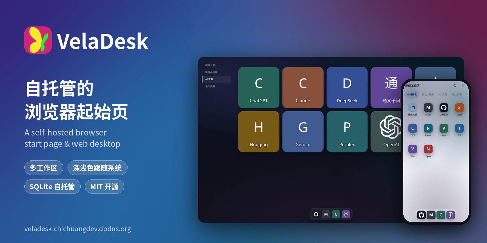
</p>

<p align="center">
  <a href="./LICENSE"></a>
  <a href="https://github.com/ichichuang/veladesk/releases/latest"></a>
  
  
  
  
  
  
</p>

<p align="center">
  <a href="https://veladesk.chichuangdev.dpdns.org"><b>在线演示</b></a> ·
  <a href="https://github.com/ichichuang/veladesk/releases/latest"><b>下载</b></a> ·
  <a href="#从源码运行"><b>从源码运行</b></a> ·
  <a href="./docs/DEVELOPMENT.md"><b>开发文档</b></a>
</p>

> 一个自己部署、自己整理的浏览器主页和网站导航桌面。

**English** — VelaDesk is a free, open-source browser start page and web desktop that you host yourself.
Organize your sites into sections, folders and a dock, keep separate workspaces for work and home,
and open everything from desktop or phone. Your data stays in a local SQLite database on your own machine.
The UI is Chinese by default; English can be switched on in Settings → General.

<p align="center">
  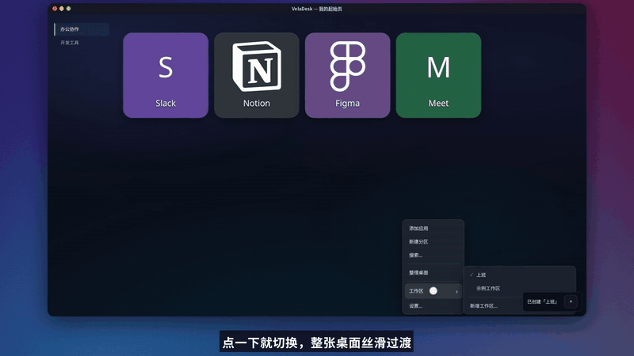
</p>

## 在线演示

👉 **https://veladesk.chichuangdev.dpdns.org**

打开后可以直接看看桌面、右键菜单、搜索和设置。

注意：演示站是一个公开实例，所有访客看到和修改的是同一份数据，请不要在里面填写任何私人信息。

## VelaDesk 是什么

VelaDesk 是一个免费开源的浏览器主页程序。

它跑在你自己的电脑上，不需要注册账号，也没有广告。

打开浏览器就能看到自己整理的网站桌面：
点一下图标打开网站，像用手机桌面一样。

数据保存在你自己部署的 VelaDesk 里，不会上传到第三方云服务。

电脑端主要用来添加、整理和设置；
手机端主要用来查看分类、搜索和打开网站。

## 能做什么

**整理网站**

- 磁贴式桌面：常用网站一个图标一个磁贴，点一下就打开
- 分区（页面）：按「前端开发」「AI 工具」这样的主题分区，左侧一键切换
- 文件夹：把同类网站收进一个文件夹
- 底部快捷栏（Dock）：最常用的几个网站固定在底部
- 在电脑端拖动、调整应用的位置，右键「整理桌面」
- 添加应用时粘贴网址，自动识别网站名称和图标；常见品牌使用内置离线图标
- 没有图标的网站显示名称的第一个字，搜索结果和面板里仍显示全名
- 使用 JSON 批量导入网站

**快速找到**

- 右键「搜索…」：输入关键字，同时搜索应用和分区，键盘 ↑ ↓ 选择、回车打开、Esc 关闭
- 手机端顶部也有搜索按钮

**多工作区**

- 第一次打开可以「一键体验示例工作区」，也可以创建空白工作区
- 右键「工作区」可以新增、切换、重命名、删除工作区（删除前会确认）
- 新增时可选模板：空白、示例·前端、示例·上班、示例·在家
- 切换工作区带过渡动画，上班一套、在家一套，互不打扰

**外观**

- 颜色模式：跟随系统（默认）、深色、浅色
- 强调色，以及「清爽 / 柔和 / 玻璃」三种界面风格
- 背景：内置「极光 / 午夜 / 晨曦 / 薄雾」，也可以上传自己的图片（PNG / JPEG / WebP / AVIF，不超过 4 MiB），可以给整个工作区或单个分区设置
- 界面语言：中文（默认）/ English

**电脑和手机都能用**

- 在手机端查看分类、搜索和打开应用
- 数据保存在自己的设备上（服务器端 SQLite，浏览器端 IndexedDB 本地副本）

## 截图

截图来自全新安装的 VelaDesk 和自带的示例工作区。

| 深色 · 桌面 | 浅色 · 桌面 |
| --- | --- |
| 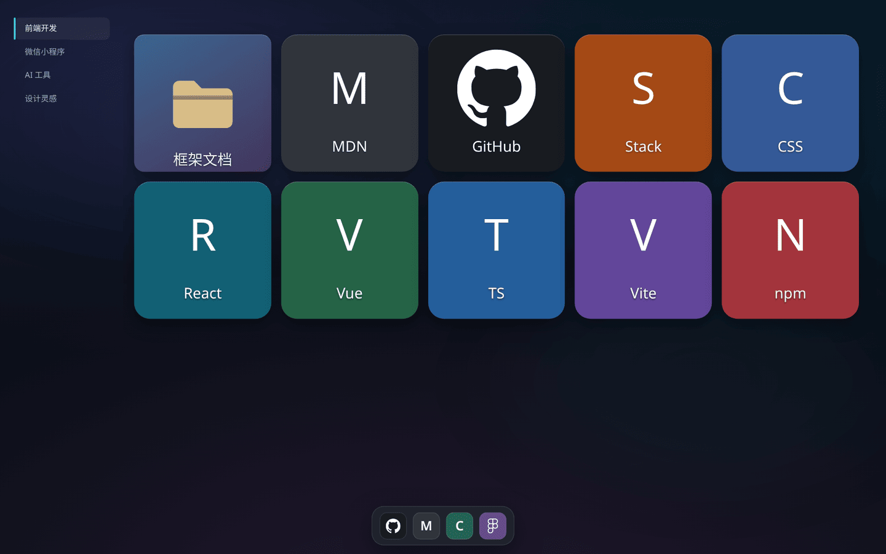 | 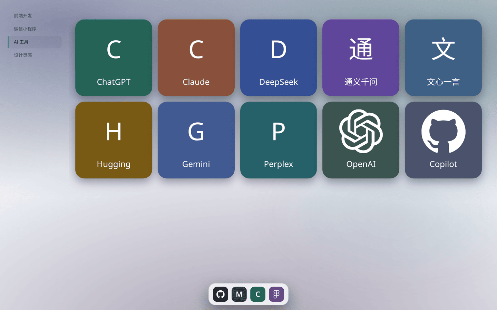 |
| **右键搜索** | **没有图标时显示首字** |
| 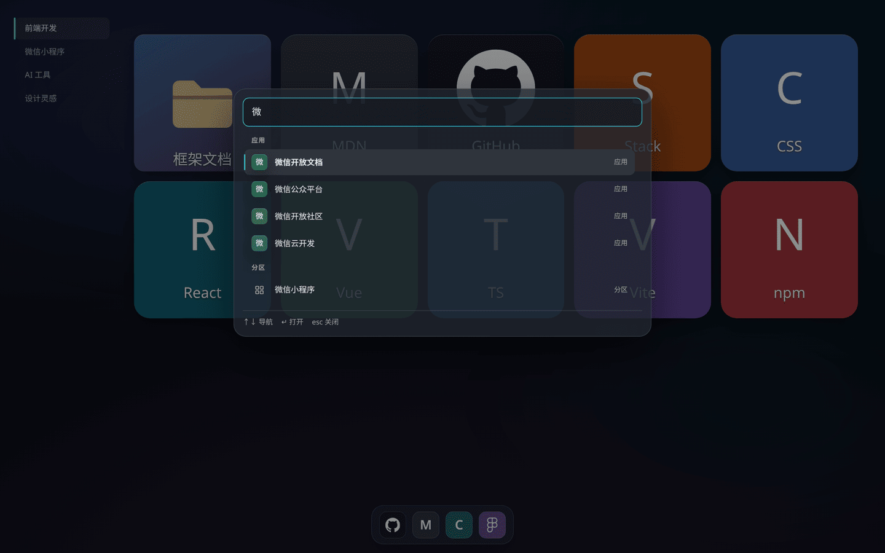 | 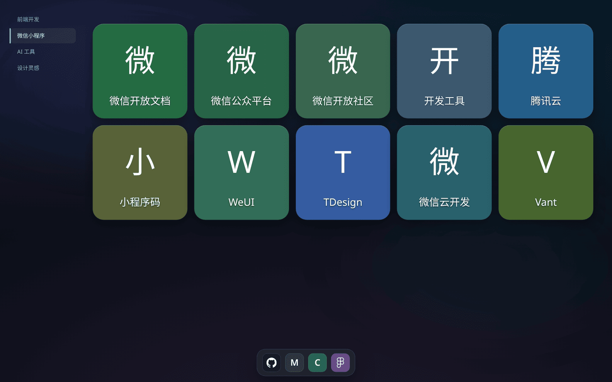 |
| **右键菜单 · 工作区** | **新增工作区（含模板）** |
| 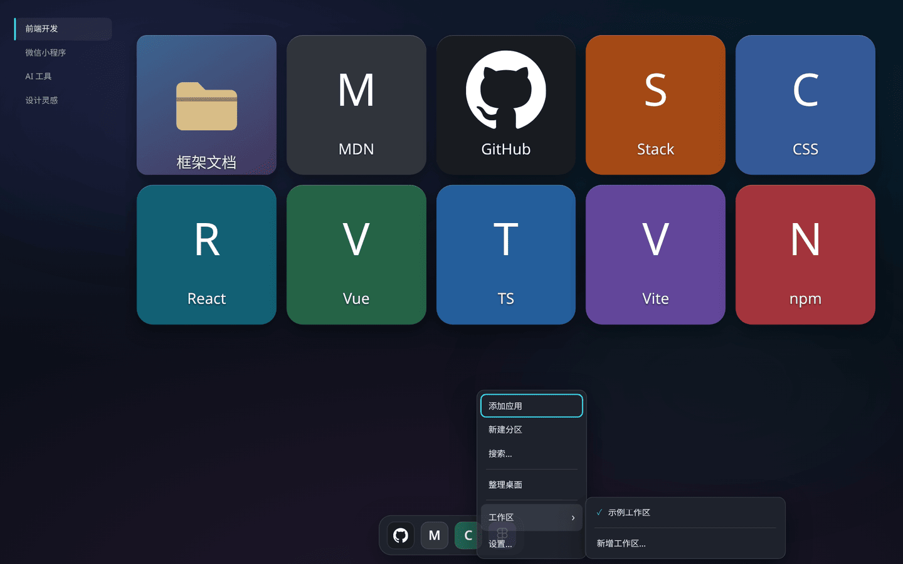 | 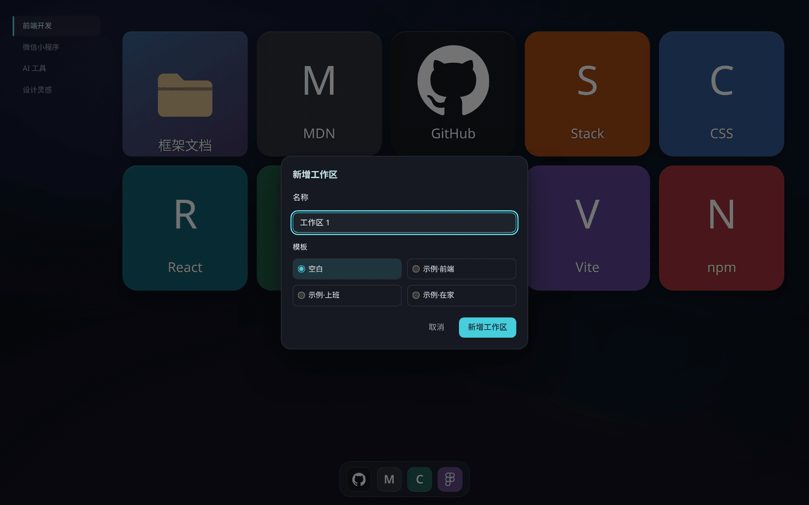 |
| **外观设置** | **第一次打开** |
| 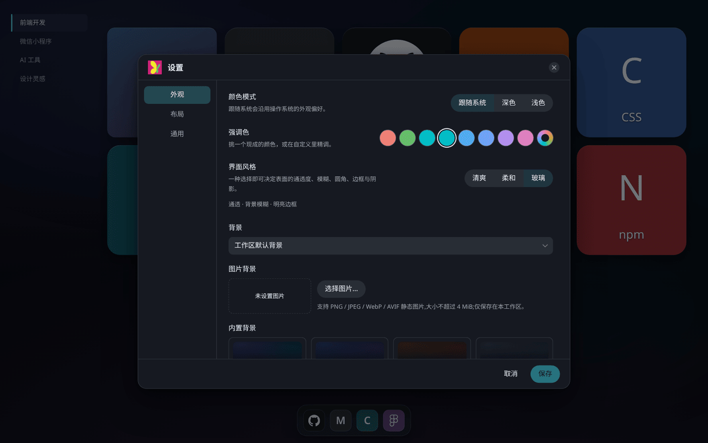 | 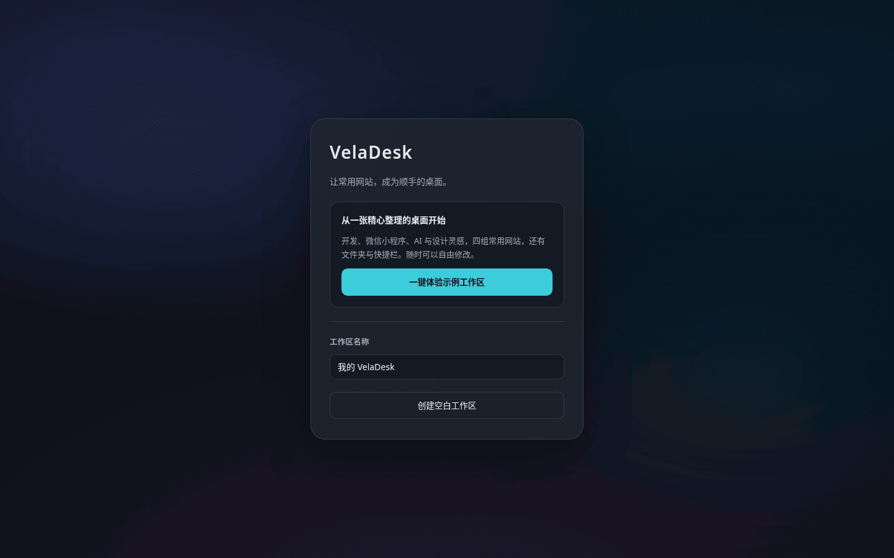 |

<p align="center">
  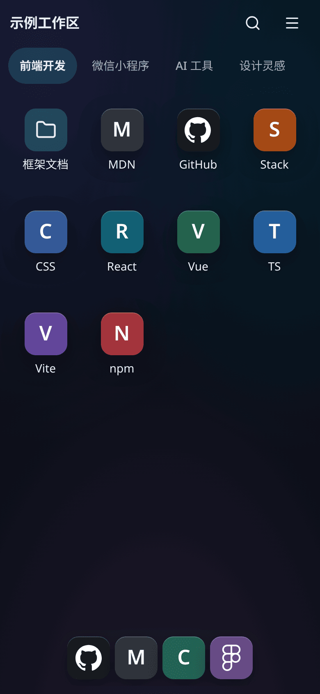
  &nbsp;&nbsp;
  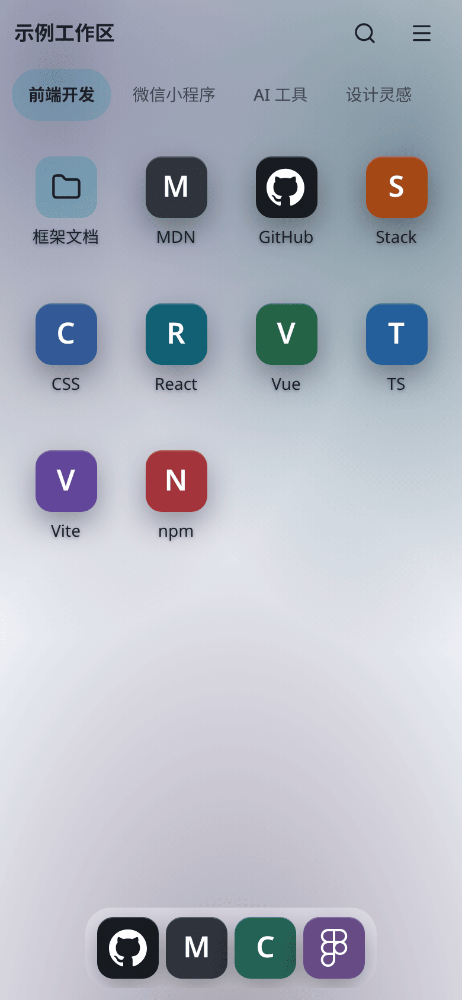
</p>

## 下载

> 当前正式版是 **v1.0.0**（2026-10-01 发布）。
> 一键示例工作区、多工作区、颜色模式跟随系统、无图标显示首字等功能是之后才加入 `main` 分支的，
> 还没有进入正式程序包。想体验这些功能，请打开[在线演示](https://veladesk.chichuangdev.dpdns.org)或[从源码运行](#从源码运行)。

下载地址：

https://github.com/ichichuang/veladesk/releases/latest

进入 Releases 页面后，在 Assets 里下载对应系统的程序包。

通用文件名：

| 系统 | 文件名 |
| --- | --- |
| Windows 64 位（Intel/AMD） | `VelaDesk-v<版本号>-windows-x64.zip` |
| Linux 64 位（Intel/AMD） | `VelaDesk-v<版本号>-linux-x64.tar.gz` |
| Mac Apple 芯片 | `VelaDesk-v<版本号>-macos-arm64.tar.gz` |

Apple 芯片 = Apple Silicon（M 系列芯片）。

目前没有提供：

- Intel Mac 正式包
- Windows ARM 正式包
- Linux ARM 正式包

注意：不要下载 GitHub 自动生成的

- `Source code (zip)`
- `Source code (tar.gz)`

它们是源码压缩包，不是能直接运行的 VelaDesk 程序包。

## 运行前准备

只需要安装一样东西：Node.js 24 LTS

下载地址：https://nodejs.org/

安装时一路默认即可。

使用正式 Release 程序包，不需要 Git、pnpm、Visual Studio、Python，
也不需要自己编译。

## Windows 使用方法

1. 安装 Node.js 24 LTS。
2. 下载 `windows-x64` 的 zip 包。
3. 解压到任意文件夹。
4. 双击 `start-veladesk.cmd`。
5. 保持启动窗口打开（关掉窗口 = 关闭 VelaDesk）。
6. 浏览器访问 http://127.0.0.1:3000。
7. 第一次打开时，按页面提示创建工作区。

## macOS 使用方法

1. 安装 Node.js 24 LTS。
2. 下载 `macos-arm64` 的程序包。
3. 解压。
4. 打开「终端」，进入解压后的目录，例如：

   ```bash
   cd ~/Downloads/VelaDesk-v1.0.0-macos-arm64
   ```

5. 运行：

   ```bash
   ./start-veladesk.sh
   ```

6. 打开 http://127.0.0.1:3000。

说明：目前只提供 Apple 芯片（Apple Silicon，M 系列）的程序包。

## Linux 使用方法

1. 安装 Node.js 24 LTS。
2. 下载 `linux-x64` 的程序包。
3. 解压。
4. 进入解压后的目录：

   ```bash
   cd VelaDesk-v1.0.0-linux-x64
   ```

5. 运行：

   ```bash
   ./start-veladesk.sh
   ```

6. 打开 http://127.0.0.1:3000。

## 手机访问电脑上的 VelaDesk

先说清楚一件事：

`http://127.0.0.1:3000` 里的 `127.0.0.1` 只代表“当前这台设备”。

所以手机不能用 `127.0.0.1` 去访问另一台电脑。
要让手机访问电脑上的 VelaDesk，需要两步：
让 VelaDesk 监听局域网，再用电脑的局域网 IP 访问。

**Windows（PowerShell）：**

```powershell
$env:VELADESK_HOST="0.0.0.0"
.\start-veladesk.cmd
```

**macOS / Linux：**

```bash
VELADESK_HOST=0.0.0.0 ./start-veladesk.sh
```

然后查看电脑的 IPv4 地址。
例如电脑 IP 是 `192.168.1.20`，手机浏览器打开：

http://192.168.1.20:3000

注意：

- 手机和电脑必须在同一个局域网 / Wi-Fi 下。
- Windows 弹出防火墙提示时，家庭网络场景只勾选“专用网络”。
- 不要把 3000 端口直接暴露到公网。

局域网开放只建议在家庭网络、内网或可信网络中使用。

### 自定义端口

不想用 3000 端口时，可以这样改。

**Windows（PowerShell）：**

```powershell
$env:VELADESK_PORT="8080"
.\start-veladesk.cmd
```

**macOS / Linux：**

```bash
VELADESK_PORT=8080 ./start-veladesk.sh
```

然后访问：

http://127.0.0.1:8080

## 数据保存在哪里

| 系统 | 数据目录 |
| --- | --- |
| Windows | `%LOCALAPPDATA%\VelaDesk` |
| macOS | `~/Library/Application Support/VelaDesk` |
| Linux | `${XDG_DATA_HOME:-$HOME/.local/share}/veladesk` |

说明：

- 工作区、数据库和上传的图片都保存在上面的用户数据目录里。
- 程序目录和用户数据是分开的。
- 升级时替换程序文件夹，不会自动删除用户数据。
- 要备份，直接备份整个 VelaDesk 数据目录即可。

## 升级

1. 下载新版本程序包。
2. 解压新的程序包。
3. 关闭旧版本（关掉启动窗口）。
4. 用新版本启动。
5. 继续使用原来的数据目录。

正常升级不需要重新建立工作区。

## 常见问题

**Q：双击以后打不开？**
A：先确认已安装 Node.js 24 LTS，并保持启动窗口打开。

**Q：浏览器打不开 127.0.0.1:3000？**
A：确认启动窗口没有报错；如果自定义过端口，请使用对应端口。

**Q：手机为什么打不开 127.0.0.1:3000？**
A：`127.0.0.1` 只代表手机自己。请按“手机访问电脑上的 VelaDesk”一节配置局域网，并使用电脑的局域网 IP。

**Q：升级会丢数据吗？**
A：程序目录和数据目录是分开的。正常替换程序包不会删除工作区；重要数据仍建议定期备份。

**Q：下载哪个文件？**
A：按系统和 CPU 架构选择 Assets 中的 VelaDesk 程序包，不要下载 Source code。

**Q：macOS/Linux 提示没有执行权限？**
A：运行一次：

```bash
chmod +x start-veladesk.sh
```

## 从源码运行

适合想体验 `main` 分支最新功能或参与开发的人。需要 Git、Node.js 24 LTS 和 pnpm 11
（版本以 `.nvmrc` 和 `package.json` 的 `packageManager` 字段为准）。

```bash
git clone https://github.com/ichichuang/veladesk.git
cd veladesk
pnpm install
pnpm dev
```

然后打开 http://localhost:3000 。

开发模式下，数据默认保存在 `apps/web/.veladesk-data/`（已被 `.gitignore` 忽略）。
想换位置可以设置 `VELADESK_DATA_DIR`：

```bash
VELADESK_DATA_DIR=/path/to/veladesk-data pnpm dev
```

## 环境变量

| 变量 | 作用 |
| --- | --- |
| `VELADESK_HOST` | 正式程序包监听的地址，默认 `127.0.0.1`（只有本机能访问）；设为 `0.0.0.0` 可让局域网访问 |
| `VELADESK_PORT` | 正式程序包监听的端口，默认 `3000` |
| `VELADESK_DATA_DIR` | 数据目录（SQLite 数据库和上传的图片）。程序包启动脚本默认使用「数据保存在哪里」一节的目录，设置它可以换位置 |
| `VELADESK_DEV_ALLOWED_ORIGINS` | 仅开发服务器使用，局域网调试时允许的来源主机名，详见 [docs/DEVELOPMENT.md](./docs/DEVELOPMENT.md) |

## 技术栈

- [Next.js 16](https://nextjs.org/)（App Router）+ React 19 + TypeScript
- Tailwind CSS 4、HeroUI、Radix UI、GSAP（动画）、dnd-kit（拖拽）
- SQLite（Drizzle 迁移）+ IndexedDB 本地优先同步
- pnpm workspace + Turborepo 单仓库，Vitest 与 Playwright 测试

## 目录结构

```text
veladesk/
├── apps/web/                 # Next.js Web 应用（页面、API、服务端）
├── packages/
│   ├── domain/               # 工作区、分区、Dock、文件夹的领域模型
│   ├── desktop-engine/       # 桌面网格、布局、碰撞与选择
│   ├── desktop-interaction/  # 像素到网格的交互映射
│   ├── canvas-engine/        # 画布几何、吸附、缩放
│   ├── database/             # SQLite 持久化与迁移
│   ├── local-store/          # IndexedDB 本地副本与 outbox
│   ├── sync/                 # 工作区同步
│   ├── client-runtime/       # 浏览器端工作区运行时
│   ├── assets/               # 图片资源管线
│   ├── icon-catalog/         # 内置离线图标目录
│   ├── ui/ · shared/         # UI 适配层与共享工具
├── docs/                     # 开发文档、架构文档、截图
└── scripts/                  # 版本与发布脚本
```

## 开发者

如果你要修改源码、参与开发或了解项目结构，请看：

[docs/DEVELOPMENT.md](./docs/DEVELOPMENT.md)

架构说明在 [docs/architecture](./docs/architecture/) 目录。

欢迎通过 [Issues](https://github.com/ichichuang/veladesk/issues) 提交想法和反馈。

## 开源协议

VelaDesk 基于 [MIT License](./LICENSE) 开源。

---

<sub>VelaDesk 参加了 WorkBuddy「1024 造物挑战」。</sub>
